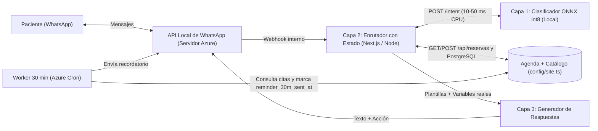
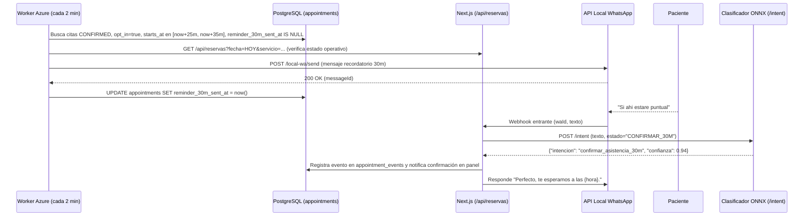

# Tarea Futura: Bot de WhatsApp con API Local y Modelo de Comprensión Orientado al Negocio

**Consultorio:** GOMEZ DELGADO DENTAL (Huamanga, Ayacucho, Perú)  
**Estado:** Diseño técnico y hoja de ruta (pendiente de implementación tras estabilizar operación manual)  
**Basado en:** Skill `modelo-inteligente-para-chatbot`, `config/site.ts`, `lib/scheduling.ts`, `app/api/reservas/route.ts` y `docs/requirements/business-rules.md`

---

## 1. Propósito y estado actual: por qué la confirmación 30 minutos antes es manual hoy

Actualmente, el sistema del consultorio ya cuenta con la base de mensajería y agenda (`whatsapp_jobs` en `lib/schema.ts`, notificaciones programadas en `lib/scheduling.ts` y el panel de mensajería en `app/panel/mensajes/page.tsx` respaldado por `/api/panel/mensajes`), además de enlaces tokenizados de autogestión (`/mi-cita/[token]` vía `/api/reservas/[token]`).

Sin embargo, **antes de habilitar el bot automático de WhatsApp**, la recepcionista realiza de forma **manual** la confirmación y recordatorio crítico **30 minutos antes de cada cita** desde el panel de recordatorios. Esta decisión operativa responde a cuatro motivos concretos de negocio:

1. **Calibrar el lenguaje real de los pacientes en Huamanga:**  
   Antes de automatizar respuestas, recepción observa cómo escriben realmente los pacientes locales (abreviaturas, notas de voz transcritas, expresiones como *"ya estoy bajando"*, *"llego en 10"*, *"se me presentó algo"*, *"cuánto está la limpieza"*). Esas frases reales son la materia prima para el dataset de entrenamiento (`intents.jsonl`).
2. **Proteger la disponibilidad del sillón y evitar falsos positivos:**  
   Una confirmación a 30 minutos de la cita admite respuestas matizadas (retraso leve, duda sobre ubicación en el centro de Huamanga, emergencia repentina). La recepcionista decide en tiempo real si mantiene el turno, aplica tolerancia o habilita el cupo para una consulta presencial (*walk-in*).
3. **Respetar el consentimiento (`opt_in`) y completar datos operativos del consultorio:**  
   En `config/site.ts` aún figuran datos de demostración pendientes de cierre (`clinic.demo: true`, `address: null`, `mapUrl: null`, `phone: "+51 966 000 000"`). Confirmar manualmente evita que un bot difunda datos incompletos o contacte a pacientes sin `opt_in = true` (regla `BR-WA-01`).
4. **Validar la fuente de verdad única sin riesgo de doble reserva:**  
   Permite comprobar en la práctica que las reglas de agenda (bloqueos de cirugías, intervalos, margen de limpieza y regla de 15 minutos previos) reflejan fielmente el ritmo diario del Lic. Edu Gómez Delgado antes de exponerlas a un flujo conversacional automático.

> **Criterio de transición:** El bot automático se habilitará solo cuando el panel manual opere sin fricciones, los datos de `config/site.ts` estén confirmados y exista un conjunto mínimo de conversaciones reales etiquetadas para validar la precisión del clasificador.

---

## 2. Arquitectura local de 3 capas

Siguiendo el patrón de `modelo-inteligente-para-chatbot`, el "cerebro" del bot se divide en **tres capas estrictamente separadas**. El modelo de IA **únicamente clasifica qué quiere el paciente**; nunca inventa precios, horarios, disponibilidad ni diagnósticos.



### Por qué local (ONNX `int8`) y no un LLM en la nube por mensaje

| Criterio | Enfoque local (Embeddings + Regresión Logística en ONNX `int8`) | LLM externo por API en cada mensaje |
| --- | --- | --- |
| **Latencia** | **10–50 ms en CPU** dentro del servidor Azure | 600–2500 ms + dependencia de red externa |
| **Costo operativo** | **$0 por mensaje** (sin cobro por tokens) | Costo variable creciente por conversación |
| **Privacidad de datos** | **100 % local:** nombres, teléfonos, DNI y motivos de consulta nunca salen del servidor (alineado con `DATA_PRIVACY.md` y `BR-SEC-02`) | Envío de PII y contexto clínico potencial a terceros |
| **Riesgo de alucinación** | **Nulo en datos:** precios y cupos vienen de `config/site.ts` y `/api/reservas` | Riesgo de inventar precios, horarios o recomendaciones médicas (`BR-WA-03`) |

---

## 3. Capa 1: Clasificador de Intención Local

### 3.1 Estrategia de modelado (Línea base -> Producción)

1. **Línea base rápida (`--mode tfidf`):**  
   Vectorizador TF-IDF (n-gramas de palabras y caracteres para tolerar errores tipográficos como *"linpieza"*, *"evaluasion"*, *"orario"*) + Regresión Logística calibrada. Se entrena en segundos sin descargas externas y establece la métrica base.
2. **Modelo de producción (`--mode embeddings` -> ONNX `int8`):**  
   Embeddings multilingües pequeños (compatibles con español latinoamericano/peruano, por ejemplo familia `paraphrase-multilingual-MiniLM-L12-v2` o `multilingual-e5-small`) + clasificador de Regresión Logística con probabilidades calibradas.
3. **Exportación y runtime mínimo:**  
   Exportar el pipeline a **ONNX cuantizado `int8`** para servirlo en CPU en **10–50 ms** mediante un microservicio local (`POST http://127.0.0.1:8001/intent`) usando únicamente `onnxruntime` y el tokenizador ligero (sin cargar PyTorch ni el stack de entrenamiento en producción).
4. **Criterio de aceptación:**  
   `accuracy >= 90 %` en conjunto de validación estratificado, F1 balanceado en clases críticas (`confirmar_asistencia_30m`, `consulta_presencial_urgencia`, `reprogramar_o_cancelar`) y alto *recall* en `otro`.

### 3.2 Intenciones exactas del consultorio dental

Se definen **8 intenciones mutuamente excluyentes**, cada una asociada a una acción de enrutamiento distinta:

| Intención | Qué expresa el paciente | Acción del enrutador |
| --- | --- | --- |
| `agendar_cita` | Quiere sacar, reservar o separar un turno nuevo (mencione o no servicio/fecha). | Inicia o continúa el flujo guiado de reserva consultando `GET /api/reservas` y creando *hold* vía `POST /api/reservas`. |
| `consultar_precios_servicios` | Pregunta cuánto cuesta o qué incluye evaluación, limpieza o control dental. | Responde con tarifas y duraciones exactas desde `config/site.ts` e invita a agendar. |
| `horarios_y_ubicacion` | Pregunta días/horas de atención, dirección en Huamanga, mapa o si atienden sábados/domingos. | Responde con `openingHours`, `clinic.address` (o `addressPlaceholder`), `mapUrl` y teléfono desde `config/site.ts`. |
| `confirmar_asistencia_30m` | Responde al recordatorio previo (*"sí confirmo"*, *"ahí estaré"*, *"ya voy saliendo"*). | Registra confirmación en la cita activa o notifica llegada próxima a recepción. |
| `reprogramar_o_cancelar` | Pide mover de hora/día o anular una cita existente. | Ubica la cita activa / enlace `/mi-cita/[token]` y ejecuta o guía `POST /api/reservas/[token]` (`reschedule` / `cancel`) respetando reglas. |
| `consulta_presencial_urgencia` | Reporta dolor agudo, sangrado, hinchazón, trauma o pregunta si puede ir de frente sin reserva previa. | Aplica `BR-WA-03` (cero diagnóstico): informa sobre atención presencial con posible espera (`walkInNotice`) y escala de inmediato a recepción si hay urgencia aguda. |
| `hablar_con_recepcion` | Pide atención humana (*"pásame con alguien"*, *"quiero hablar con la señorita"*, *"tengo un caso especial"*). | Pausa el bot (`escalado_humano = true`) y transfiere el chat a recepción con resumen de la sesión. |
| `otro` | Saludos sueltos sin continuidad, spam, temas ajenos al consultorio o frases ininteligibles. | Si es primer saludo, da bienvenida breve; si es fuera de dominio, responde sin inventar y ofrece menú de opciones o recepción. |

### 3.3 Contrato del endpoint local `POST /intent`

El clasificador carga el modelo ONNX una sola vez al arrancar y expone un contrato interno idéntico al estándar del skill:

```json
// Request: POST http://127.0.0.1:8001/intent
{
  "mensaje": "buenas, cuanto esta una linpieza y tienen para mañana en la tarde?",
  "historial_reciente": [
    { "rol": "bot", "texto": "Hola, bienvenido a GOMEZ DELGADO DENTAL." }
  ],
  "estado": {
    "ultima_intencion": null,
    "flujo_activo": null
  }
}

// Response: 200 OK (~18 ms CPU)
{
  "intencion": "consultar_precios_servicios",
  "confianza": 0.89,
  "necesita_aclaracion": false,
  "pregunta_aclaracion": null
}
```

### 3.4 Umbrales de confianza calibrados

Los umbrales se calibran sobre el conjunto de validación priorizando evitar **errores caros** (por ejemplo, interpretar una cancelación o una urgencia con dolor como una consulta genérica):

| Rango de confianza (`p`) | Comportamiento del sistema |
| --- | --- |
| **`p >= 0.78`** | **Ejecución directa:** El enrutador confía en la intención y ejecuta el paso correspondiente según `flujo_activo`. |
| **`0.50 <= p < 0.78`** | **Aclaración guiada (`necesita_aclaracion: true`):** El bot no adivina. Presenta las 2 intenciones candidatas o un menú breve numerado (ej. *"¿Deseas: 1) Ver precios, 2) Agendar una cita, o 3) Hablar con recepción?"*). |
| **`p < 0.50` o `otro`** | **Fallback seguro:** No ejecuta cambios en agenda. Registra el turno para reentrenamiento semanal y ofrece opciones concretas. Tras **2 turnos seguidos** con `p < 0.50`, escala automáticamente a recepción (`BR-WA-05`). |
| **Excepción de seguridad (`consulta_presencial_urgencia`)** | Si la probabilidad de `consulta_presencial_urgencia` supera **`0.45`** (o coincide con señal de dolor agudo/sangrado/trauma en validación de seguridad), prevalece la derivación segura y el aviso de atención presencial sin intentar vender ni diagnosticar. |

### 3.5 Dataset semilla en `intents.jsonl`

Para entrenar inicialmente se parte de un archivo `data/intents.jsonl` (mínimo **40–60 ejemplos por intención** y **100+ ejemplos para `otro`** antes de producción, incluyendo faltas de ortografía, ausencia de tildes, mensajes cortos y modismos de Ayacucho/Perú). A continuación se muestra la **semilla inicial validada para arrancar el pipeline**:

```jsonl
{"text": "quiero sacar una cita para mañana", "intent": "agendar_cita"}
{"text": "kiero separar turno con el doctor edu", "intent": "agendar_cita"}
{"text": "tienen horario disponible el sabado?", "intent": "agendar_cita"}
{"text": "necesito agendar limpieza dental", "intent": "agendar_cita"}
{"text": "hay cupo hoy en la tarde", "intent": "agendar_cita"}
{"text": "me puedes reservar para evaluacion", "intent": "agendar_cita"}
{"text": "cuanto cuesta la limpieza dental?", "intent": "consultar_precios_servicios"}
{"text": "precio de la evaluacion porfa", "intent": "consultar_precios_servicios"}
{"text": "cuanto esta el control", "intent": "consultar_precios_servicios"}
{"text": "q servicios tienen y cuanto cobran", "intent": "consultar_precios_servicios"}
{"text": "cuanto sale una consulta dental", "intent": "consultar_precios_servicios"}
{"text": "donde quedan ubicados en huamanga?", "intent": "horarios_y_ubicacion"}
{"text": "cual es su direccion exacta y horario", "intent": "horarios_y_ubicacion"}
{"text": "atienden los domingos?", "intent": "horarios_y_ubicacion"}
{"text": "a que hora cierran hoy", "intent": "horarios_y_ubicacion"}
{"text": "mandeme su ubicacion x maps", "intent": "horarios_y_ubicacion"}
{"text": "si confirmo mi cita de hoy", "intent": "confirmar_asistencia_30m"}
{"text": "ahi estare puntual gracias", "intent": "confirmar_asistencia_30m"}
{"text": "ya estoy yendo al consultorio", "intent": "confirmar_asistencia_30m"}
{"text": "si asisto en 30 minutos", "intent": "confirmar_asistencia_30m"}
{"text": "ok confirmado nos vemos ahorita", "intent": "confirmar_asistencia_30m"}
{"text": "quiero cambiar la hora de mi cita", "intent": "reprogramar_o_cancelar"}
{"text": "ya no voy a poder ir hoy, deseo cancelar", "intent": "reprogramar_o_cancelar"}
{"text": "se puede pasar mi turno para otro dia?", "intent": "reprogramar_o_cancelar"}
{"text": "necesito anular mi reserva xfa", "intent": "reprogramar_o_cancelar"}
{"text": "reprogramar cita", "intent": "reprogramar_o_cancelar"}
{"text": "me duele horrible la muela puedo ir ahorita sin cita?", "intent": "consulta_presencial_urgencia"}
{"text": "tengo mucho sangrado en la encia atienden de emergencia?", "intent": "consulta_presencial_urgencia"}
{"text": "se me rompio un diente ahorita puedo acercarme de frente", "intent": "consulta_presencial_urgencia"}
{"text": "falta menos de 15 min para el turno, puedo ir presencial?", "intent": "consulta_presencial_urgencia"}
{"text": "hay atencion presencial si voy directo al consultorio?", "intent": "consulta_presencial_urgencia"}
{"text": "quiero hablar con la recepcionista", "intent": "hablar_con_recepcion"}
{"text": "pasame con una persona por favor", "intent": "hablar_con_recepcion"}
{"text": "alguien que me atienda por llamada o chat", "intent": "hablar_con_recepcion"}
{"text": "tengo una consulta especial necesito hablar con recepcion", "intent": "hablar_con_recepcion"}
{"text": "buenas tardes", "intent": "otro"}
{"text": "hola", "intent": "otro"}
{"text": "venden cepillos por mayor?", "intent": "otro"}
{"text": "cuanto cuesta un pasaje a lima", "intent": "otro"}
{"text": "ok gracias", "intent": "otro"}
```

---

## 4. Capa 2: Enrutador de Conversación con Estado y Reglas del Consultorio

El enrutador vive en código propio (TypeScript dentro de la aplicación Next.js o servicio de orquestación) y es el **único responsable de decidir qué hacer**, manteniendo el estado de sesión del paciente por número de WhatsApp (`wa_id`) y consultando siempre los datos reales del negocio.

### 4.1 Fuente de verdad: `config/site.ts` y `GET /api/reservas`

El enrutador **nunca** guarda precios ni cupos estáticos. Al iniciar o refrescar contexto lee:

1. **Catálogo y configuración en `config/site.ts` (vía `GET /api/catalogo` o importación directa en servidor):**
   - **Consultorio:** `GOMEZ DELGADO DENTAL` (`Huamanga, Ayacucho, Perú`, `timeZone: "America/Lima"`).
   - **Profesional habilitado:** `Lic. Edu Gómez Delgado` (`id: "odonto-a"`, Odontología Integral y Estética).
   - **Servicios vigentes:**
     - `evaluacion` — **Evaluación dental**: `30 min`, **S/ 80.00** (`priceCents: 8000`).
     - `limpieza` — **Limpieza dental**: `45 min`, **S/ 120.00** (`priceCents: 12000`).
     - `control` — **Control dental**: `30 min`, **S/ 90.00** (`priceCents: 9000`).
   - **Horario oficial:** Lunes a sábado (`workingDays: [1, 2, 3, 4, 5, 6]`), **09:00–17:00** (`openingHour: 9`, `closingHour: 17`), domingos cerrado.
2. **Disponibilidad real en `GET /api/reservas` (`dailyReservasAvailability` / `monthlyReservasAvailability` en `lib/scheduling.ts`):**
   - Parámetros diarios: `GET /api/reservas?fecha=YYYY-MM-DD&servicio=evaluacion|limpieza|control&profesional=odonto-a`
   - Parámetros mensuales: `GET /api/reservas?mes=YYYY-MM&servicio=...`
   - Devuelve: `reservable`, `estadoDia` (`AVAILABLE`, `CUTOFF_WALKIN`, `AFTER_HOURS`, `FULL`, `CLOSED`, `PAST`, `OUT_OF_RANGE`), `minAdvanceMinutes`, `walkInDisponible`, `mensajeWalkIn`, `horariosDisponibles`, `horariosOcupados` y `slots`.

### 4.2 Reglas operativas obligatorias en el enrutador

El enrutador respeta y traduce al diálogo las mismas invariantes que `lib/scheduling.ts` aplica en PostgreSQL (`EXCLUDE USING gist`):

1. **Intervalos de agenda y servicios de 45 min que ocupan 2 bloques:**
   - La agenda comercial se presenta al paciente en **intervalos estándar de 30 minutos** (como en `evaluacion` y `control` de 30 min; en `config/site.ts` la grilla técnica actual es `slotMinutes: 15` con `bufferMinutes: 10` para calcular `occupied_until`).
   - Cuando el paciente elige **Limpieza dental (`limpieza`, duración 45 min)**, `durationTimes()` suma `45 min + 10 min` de limpieza (`55 min` totales ocupados hasta `occupied_until`), por lo que **ocupa 2 bloques consecutivos de 30 min** (p. ej. si empieza a las `10:00`, bloquea hasta `10:55`, impidiendo agendar otro turno a las `10:30`). El bot consulta `GET /api/reservas?servicio=limpieza&fecha=...` para ofrecer **solo horas de inicio donde ambos bloques estén libres** y jamás promete un turno de 30 min suelto para una limpieza.
2. **Regla de 15 minutos previos y consultas presenciales con posible espera:**
   - `schedule.minAdvanceMinutes = 15`: toda reserva en línea exige al menos **15 minutos de anticipación**.
   - Si el paciente solicita un turno dentro de los próximos 15 minutos (o cuando `estadoDia === "CUTOFF_WALKIN"` con `walkInDisponible === true`), `POST /api/reservas` rechaza el *hold* en línea (HTTP `409`). El enrutador no insiste en reservar ese turno por bot: muestra `clinic.walkInNotice` (*"se aceptan consultas presenciales directamente en el consultorio (con posible espera)"*) y ofrece alternativamente el próximo horario disponible en línea (`GET /api/disponibilidad/proxima`).
   - Si el consultorio ya cerró hoy (`estadoDia === "AFTER_HOURS"`), informa que las reservas web del día finalizaron y ofrece consultar el siguiente día laborable.
3. **Bloqueos de cirugías, feriados y días libres de doctores (`agenda_blocks`):**
   - Recepción/administración registra bloqueos desde `/api/panel/agenda` (`action: "block"`, por ejemplo cirugías prolongadas, reuniones clínicas o días libres del odontólogo).
   - `availableSlots()` y `overlapping()` en `lib/scheduling.ts` cruzan `appointments` con `agenda_blocks`. Por ello, el enrutador solo ofrece horas presentes en `horariosDisponibles` de `GET /api/reservas` y vuelve a validar antes de invocar `POST /api/reservas`.
4. **Holds temporales e idempotencia:**
   - Al confirmar datos del paciente (`nombre`, `teléfono`/`DNI`, `servicio`, `fecha`, `hora`), el bot envía `POST /api/reservas` con cabecera `Idempotency-Key` (derivada del `message_id` o `session_step_id`) y `whatsappOptIn: true`, generando una retención `PENDING` de **10 minutos** y el enlace `/mi-cita/[token]`. Luego confirma vía `POST /api/reservas/[token]` (`action: "confirm"`) si el paciente ratifica en el chat.

### 4.3 Estado de sesión (`ConversationState`) y reglas de experiencia

```ts
type ConversationState = {
  waId: string;                     // Teléfono normalizado del paciente
  saludoEnviado: boolean;           // Evita repetir la presentación en cada turno
  ultimaIntencion: string | null;
  flujoActivo:
    | null
    | "AGENDAR_SERVICIO"
    | "AGENDAR_FECHA"
    | "AGENDAR_HORA"
    | "AGENDAR_DATOS"
    | "AGENDAR_CONFIRMAR"
    | "CONFIRMAR_30M"
    | "REPROGRAMAR_O_CANCELAR"
    | "ESCALADO_RECEPCION";
  servicioId: "evaluacion" | "limpieza" | "control" | null;
  fecha: string | null;             // YYYY-MM-DD
  hora: string | null;              // HH:MM
  profesionalId: string;            // Por defecto "odonto-a" o "any"
  appointmentId: string | null;     // Cita asociada si existe
  manageToken: string | null;       // Token para POST /api/reservas/[token]
  turnosBajaConfianza: number;      // Contador para handoff automático (>= 2)
  actualizadoEn: string;            // ISO timestamp (TTL sugerido: 30 min)
};
```

**Reglas de conversación en el enrutador:**
- **No repetir presentación:** Si `saludoEnviado === true`, ir directo al grano.
- **Conservar selecciones previas:** Si el paciente ya eligió `servicioId = "limpieza"` y luego pregunta *"¿y cuánto cuesta?"*, el bot responde el precio de `limpieza` desde `config/site.ts` y retoma `AGENDAR_FECHA` sin reiniciar el flujo.
- **Cambio de tema limpio:** Si estando en `AGENDAR_HORA` el paciente escribe *"¿dónde quedan?"*, responde `horarios_y_ubicacion` y ofrece continuar con su reserva de `limpieza`.
- **Cero diagnóstico médico (`BR-WA-03`):** Ante dolor agudo, sangrado o trauma, no sugiere medicamentos ni diagnósticos; deriva a atención presencial / contacto directo con recepción.

---

## 5. Capa 3: Generador de Respuestas + API Local de WhatsApp

### 5.1 Plantillas con datos reales del catálogo

Cada intención cuenta con **2 a 3 variaciones de plantilla** que rellenan sus variables únicamente desde `config/site.ts` y las respuestas de `/api/reservas`. Si un campo sigue pendiente en `config/site.ts` (actualmente `address` y `mapUrl` son `null`), debe usarse el marcador explícito o el `addressPlaceholder` hasta completarlo:

- **`consultar_precios_servicios` (variación A):**  
  *"En {clinic.name} ({clinic.location}) atendemos con el {professional.title} {professional.name}:  
  • Evaluación dental ({evaluacion.duration} min): S/ 80.00  
  • Limpieza dental ({limpieza.duration} min): S/ 120.00  
  • Control dental ({control.duration} min): S/ 90.00  
  ¿Para cuál de estos servicios deseas ver horarios disponibles?"*
- **`horarios_y_ubicacion`:**  
  *"Atendemos de {openingHours} (hora de Lima) en {clinic.address ?? '[COMPLETAR: Dirección exacta en Huamanga]'}. Teléfono de recepción: {clinic.phone}. ¿Te gustaría agendar una cita o consultar por atención presencial hoy?"*
- **`confirmar_asistencia_30m` (recordatorio saliente):**  
  *"Hola {patientName}, te recordamos tu cita de {serviceName} hoy a las {time} en {clinic.name} con el {professionalName}. Por favor responde **SÍ** para confirmar tu asistencia o **CAMBIAR** si necesitas reprogramar."*

> **Pendientes `[COMPLETAR]` detectados en `config/site.ts`:**
> - `clinic.address` (`null` -> completar dirección exacta en el centro de Huamanga).
> - `clinic.mapUrl` (`null` -> completar enlace de Google Maps).
> - `clinic.phone` (`+51 966 000 000` -> reemplazar número de demostración por la línea oficial).
> - `clinic.demo` (`true` -> pasar a `false` en producción).

### 5.2 Puente / API Local de WhatsApp en el servidor Azure y flujo `reminder_30m_sent_at`

En el servidor Azure donde reside la aplicación Next.js + PostgreSQL se ejecuta un **puente/API local de WhatsApp** (por ejemplo, servicio contenedorizado local en `http://127.0.0.1:8080` conectado al número del consultorio, protegido con `API_KEY` local y opcionalmente con adaptador hacia Meta Cloud API para plantillas fuera de ventana de 24 h según `BR-WA-02`).

#### Extensión mínima de esquema para el recordatorio de 30 minutos

Para evitar envíos duplicados y coordinar el trabajo entre el panel manual actual y el worker automático, se agrega la marca temporal `reminder_30m_sent_at` en `appointments`:

```sql
ALTER TABLE appointments
  ADD COLUMN IF NOT EXISTS reminder_30m_sent_at timestamptz;

CREATE INDEX IF NOT EXISTS appointments_reminder_30m_idx
  ON appointments (starts_at)
  WHERE status = 'CONFIRMED' AND opt_in = true AND reminder_30m_sent_at IS NULL;
```

#### Secuencia del recordatorio 30 minutos antes



#### Ejemplo de puente local (TypeScript) consumiendo `/api/reservas` y marcando `reminder_30m_sent_at`

```ts
// Ejemplo conceptual del worker/puente en el servidor Azure
const NEXT_BASE_URL = process.env.INTERNAL_APP_URL ?? "http://127.0.0.1:3000";
const LOCAL_WA_URL = process.env.LOCAL_WA_API_URL ?? "http://127.0.0.1:8080";
const LOCAL_WA_KEY = process.env.LOCAL_WA_API_KEY!;
const INTENT_URL = process.env.LOCAL_INTENT_URL ?? "http://127.0.0.1:8001/intent";

export async function runReminder30mCycle(db: Sql) {
  // 1. Consultar citas confirmadas próximas (ventana 25 a 35 min antes)
  const { rows } = await db.query<{
    id: string; patientName: string; phone: string; serviceId: string;
    serviceName: string; professionalName: string; startsAt: Date;
  }>(`
    SELECT a.id, p.name AS "patientName", p.phone, a.service_id AS "serviceId",
           a.service_name AS "serviceName", a.professional_name AS "professionalName",
           a.starts_at AS "startsAt"
      FROM appointments a
      JOIN patients p ON p.id = a.patient_id
     WHERE a.status = 'CONFIRMED'
       AND a.opt_in = true
       AND a.reminder_30m_sent_at IS NULL
       AND a.starts_at BETWEEN now() + interval '25 minutes' AND now() + interval '35 minutes'
     FOR UPDATE OF a SKIP LOCKED
  `);

  for (const appt of rows) {
    const fechaLima = formatLimaDate(appt.startsAt); // YYYY-MM-DD
    const horaLima = formatLimaTime(appt.startsAt);  // HH:MM

    // 2. Verificar reglas y estado vigente del día vía GET /api/reservas
    const res = await fetch(
      `${NEXT_BASE_URL}/api/reservas?fecha=${fechaLima}&servicio=${appt.serviceId}`,
    );
    if (!res.ok) continue;
    const reservasDay = await res.json();
    if (reservasDay.estadoDia === "CLOSED") continue;

    // 3. Enviar por API Local de WhatsApp en el mismo servidor Azure
    const text =
      `Hola ${appt.patientName}, te recordamos tu cita de ${appt.serviceName} ` +
      `hoy a las ${horaLima} en GOMEZ DELGADO DENTAL con ${appt.professionalName}. ` +
      `Responde SÍ para confirmar o CAMBIAR si necesitas reprogramar.`;

    const waRes = await fetch(`${LOCAL_WA_URL}/messages/send`, {
      method: "POST",
      headers: { "Content-Type": "application/json", "x-api-key": LOCAL_WA_KEY },
      body: JSON.stringify({ to: appt.phone, text }),
    });

    // 4. Marcar reminder_30m_sent_at solo si el envío local fue aceptado
    if (waRes.ok) {
      await db.query(
        "UPDATE appointments SET reminder_30m_sent_at = now() WHERE id = $1",
        [appt.id],
      );
      await db.query(
        "INSERT INTO appointment_events (id, appointment_id, action, reason) VALUES ($1, $2, 'REMINDER_30M_SENT', 'Bot local WhatsApp')",
        [crypto.randomUUID(), appt.id],
      );
    }
  }
}

export async function handleIncomingWhatsApp(waId: string, text: string, state: ConversationState) {
  // Clasificación local (10-50 ms en CPU)
  const intentRes = await fetch(INTENT_URL, {
    method: "POST",
    headers: { "Content-Type": "application/json" },
    body: JSON.stringify({
      mensaje: text,
      historial_reciente: [],
      estado: { ultima_intencion: state.ultimaIntencion, flujo_activo: state.flujoActivo },
    }),
  }).then((r) => r.json());

  // Si pregunta por horarios para hoy o un servicio, el enrutador consulta GET /api/reservas
  // Ejemplo: GET /api/reservas?fecha=2026-11-25&servicio=limpieza
  return { intentRes, state };
}
```

---

## 6. Plan de fases e instrumentación semanal

### 6.1 Hoja de ruta por fases

| Fase | Objetivo principal | Entregables y criterio de salida |
| --- | --- | --- |
| **Fase 0: Operación manual y cierre de datos** *(actual)* | Consolidar el panel de recordatorios manual (30 min antes) y completar `config/site.ts`. | Recepción registra al menos **150–250 mensajes reales** de pacientes; `clinic.address`, `mapUrl`, `phone` real y `demo: false` validados. |
| **Fase 1: Clasificador TF-IDF + Modo asistido** | Validar pipeline con `intents.jsonl` ampliado (40–60 ejemplos/clase, 100+ en `otro`). | Modelo TF-IDF con `accuracy >= 85 %` sugiriendo respuestas a la recepcionista en modo sombra/asistido (sin envío autónomo todavía). |
| **Fase 2: ONNX `int8` + Recordatorio 30m automático** | Desplegar embeddings multilingües cuantizados (`int8`, 10–50 ms en CPU), API local de WhatsApp y worker `reminder_30m_sent_at`. | `accuracy >= 90 %` en validación; pruebas conversacionales completas superadas; envío automático de recordatorios 30m con manejo de `confirmar_asistencia_30m` y derivación a recepción. |
| **Fase 3: Autoservicio conversacional completo** | Habilitar reserva (`POST /api/reservas`), reprogramación y cancelación (`POST /api/reservas/[token]`) directo por WhatsApp. | Tasa de *no-show* `< 10 %`, respuesta a recordatorios `> 60 %` y cero dobles reservas frente a `agenda_blocks` y regla de 15 min. |

### 6.2 Instrumentación semanal y ciclo de reentrenamiento

Para evitar parches manuales con palabras clave (antipatrón principal según `modelo-inteligente-para-chatbot`), cada turno del bot se registra en formato **JSON Lines** (`logs/bot_turns.jsonl`), evitando exponer historia clínica y enmascarando DNI/teléfonos completos en el texto analizado:

```json
{
  "timestamp": "2026-11-24T15:32:10-05:00",
  "session_hash": "8f2a9c...",
  "mensaje": "cuanto cuesta la limpiesa y si tienen hoy a las 4",
  "intencion": "consultar_precios_servicios",
  "confianza": 0.64,
  "necesito_aclaracion": true,
  "flujo_activo": null,
  "accion_enrutador": "ACLARAR_PRECIO_O_AGENDAR",
  "escalado_humano": false,
  "resultado_cita": "HOLD_CREADO"
}
```

#### Rutina semanal (cada viernes al cierre, ~20 minutos)

1. **Exportación automática de baja confianza:**  
   Un script filtra de `logs/bot_turns.jsonl` los turnos de los últimos 7 días donde:
   - `confianza < 0.78` (banda de aclaración o fallback), o
   - `intencion == "otro"`, o
   - `escalado_humano == true` por incomprensión del bot.
2. **Etiquetado humano rápido:**  
   Recepción o el responsable técnico revisa el CSV/JSONL exportado (habitualmente 20–50 frases nuevas por semana) y asigna la intención correcta de las 8 clases.
3. **Actualización de `intents.jsonl` y reentrenamiento:**  
   Se agregan las frases reales etiquetadas a `data/intents.jsonl`, se reentrena el modelo (comparando TF-IDF vs Embeddings + Regresión Logística), se revisa la matriz de confusión y se verifica `accuracy >= 90 %` y las pruebas conversacionales de regresión (saludo repetido, cambio de tema, regla de 15 min, servicio de 45 min ocupando 2 bloques).
4. **Publicación del nuevo `.onnx` cuantizado (`int8`):**  
   Se reemplaza el artefacto ONNX y se reinicia el microservicio local en Azure con latencia verificada en **10–50 ms**.
