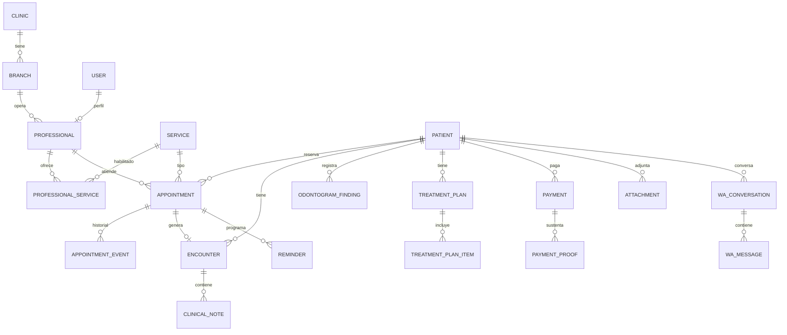

# Modelo de datos — versión preliminar

**Estado:** borrador para validación
**Fecha:** 2026-11-23
**Motor:** PostgreSQL 15+ (Supabase)

Este documento define las entidades del MVP. No es todavía el esquema definitivo: faltan confirmar reglas de agenda y retención.

## 1. Diagrama de agenda, pacientes y dinero



## 2. Diccionario resumido

| Tabla | Propósito | Restricciones clave |
|---|---|---|
| `clinics` | Configuración global | Una fila en el MVP; zona horaria `America/Lima`, moneda `PEN` |
| `branches` | Sede física | `clinic_id`; dirección y teléfono |
| `users` | Personal del consultorio | Vinculado a `auth.users`; email único |
| `user_roles` | Roles por usuario | `UNIQUE(user_id, role)` |
| `professionals` | Odontólogo | `user_id` único; colegiatura; color de agenda |
| `services` | Servicio odontológico | Duración > 0; precio referencial `numeric(12,2)` |
| `professional_services` | Servicios que puede realizar cada odontólogo | `UNIQUE(professional_id, service_id)` |
| `availability_rules` | Horario recurrente | Día de semana, hora inicio/fin, vigencia |
| `time_off` | Vacaciones y bloqueos | Rango temporal; motivo |
| `patients` | Ficha del paciente | Documento único por clínica; teléfono normalizado |
| `patient_consents` | Consentimientos | Tipo, versión, fecha, archivo, revocación |
| `appointments` | Cita | `starts_at < ends_at`; estado; `hold_expires_at` |
| `appointment_events` | Historial de estados | Append-only; actor y motivo |
| `encounters` | Atención clínica | Una por cita; profesional y paciente |
| `clinical_notes` | Nota clínica | Append-only; enmienda referencia a la anterior |
| `odontogram_findings` | Hallazgo por pieza/superficie | Pieza FDI 11–48; superficie opcional |
| `treatment_plans` | Plan de tratamiento | Estado y monto total |
| `treatment_plan_items` | Ítem del plan | Servicio, pieza, precio, estado |
| `attachments` | Radiografías y documentos | Ruta privada; MIME; tamaño; autor |
| `payments` | Pago manual | Monto > 0; método; estado; verificador |
| `payment_proofs` | Comprobante | Ruta privada; autor; fecha |
| `wa_conversations` | Conversación de WhatsApp | Teléfono único por ventana |
| `wa_messages` | Mensaje individual | `wa_message_id` único; dirección; estado |
| `reminders` | Recordatorio programado | Cita, tipo, fecha de envío, estado |
| `audit_logs` | Auditoría | Append-only; actor, acción, entidad, metadatos |
| `settings` | Configuración editable | `clinic_id` + clave única; valor JSON |

## 3. Estados

**Cita:** `PENDING → CONFIRMED → CHECKED_IN → IN_PROGRESS → COMPLETED`, con salidas a `CANCELLED` y `NO_SHOW`.

**Pago:** `PENDING → UNDER_REVIEW → CONFIRMED` o `REJECTED`; `REFUNDED` solo por administrador.

**Plan:** `DRAFT → PROPOSED → ACCEPTED → IN_PROGRESS → COMPLETED`, con `CANCELLED`.

**Encuentro:** `DRAFT → SIGNED`; las correcciones posteriores son enmiendas.

## 4. Restricción antidual de agenda

La garantía no depende del código de aplicación. Se implementa en PostgreSQL:

```sql
CREATE EXTENSION IF NOT EXISTS btree_gist;

ALTER TABLE appointments
ADD CONSTRAINT appointments_no_overlap
EXCLUDE USING gist (
  professional_id WITH =,
  tstzrange(starts_at, ends_at) WITH &&
)
WHERE (status IN ('PENDING', 'CONFIRMED', 'CHECKED_IN', 'IN_PROGRESS'));
```

Los estados terminales quedan fuera, de modo que una cita cancelada no bloquea el slot.

## 5. Índices previstos

- `appointments (professional_id, starts_at)` para la agenda diaria.
- `appointments (patient_id, starts_at DESC)` para el historial del paciente.
- `patients (clinic_id, doc_number)` único.
- `payments (patient_id, created_at DESC)`.
- `reminders (scheduled_at, status)` para el proceso de envío.
- `audit_logs (entity, entity_id, created_at DESC)`.
- Búsqueda de paciente por apellido y teléfono (trigram o índice compuesto).

## 6. Reglas de integridad y borrado

- Dinero en `numeric(12,2)`; nunca `float`.
- Fechas en UTC; presentación en `America/Lima`.
- No se borran citas, encuentros, notas, pagos ni auditoría: se cambia de estado o se enmienda.
- `ON DELETE RESTRICT` en relaciones clínicas y de pago. `CASCADE` solo en datos auxiliares.
- Los archivos se guardan en bucket privado; la base solo almacena metadatos.
- El odontograma es histórico: un nuevo hallazgo no sobrescribe el anterior.
- El `total` del plan se calcula desde sus ítems, no se edita a mano.

## 7. Pendiente de validar

1. ¿Se permite más de una cita por paciente en el mismo día?
2. ¿La duración incluye el margen de limpieza o se suma aparte?
3. ¿Recepción puede ver diagnósticos o solo datos administrativos?
4. ¿Se registran menores con tutor? ¿Qué datos del tutor se guardan?
5. ¿Se necesita historia clínica por sede en el futuro?
6. ¿Qué plazo de retención exige la normativa aplicable?
