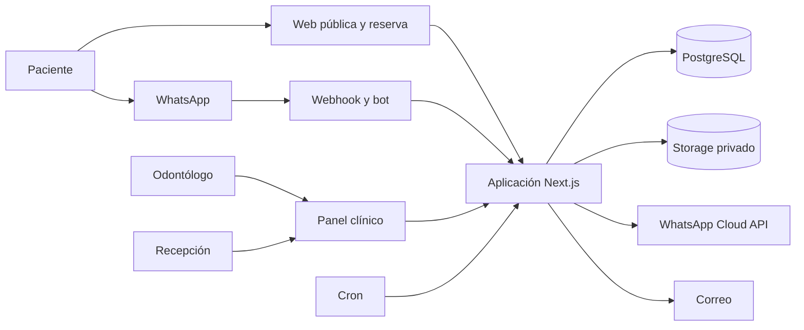

# ADR-001 — Arquitectura y stack del MVP

**Estado:** aprobado — 2026-11-23
**Fecha:** 2026-11-23
**Decisores:** propietario del consultorio, responsable técnico

## 1. Contexto

Consultorio dental en Perú, una sede, varios odontólogos. Se necesita landing, reserva online, agenda, historia clínica, pagos manuales y mensajería por WhatsApp. Equipo pequeño, presupuesto acotado y necesidad de salir a producción en meses, no años.

El dominio tiene dos zonas con exigencias distintas:

- **Zona transaccional:** agenda, reservas, pagos. Requiere consistencia y control de concurrencia.
- **Zona clínica:** historia clínica, adjuntos, auditoría. Requiere confidencialidad, trazabilidad y retención.

## 2. Alternativas evaluadas

| Criterio | Next.js + Supabase | Laravel + Filament | Django |
|---|---|---|---|
| Velocidad de MVP | Alta | Muy alta para paneles CRUD | Media |
| Ecosistema frontend | Excelente | Limitado si se busca SPA | Limitado |
| Tiempo real | Integrado | Requiere configuración | Requiere canales |
| Auth y storage | Administrados | Manual o paquetes | Manual |
| Control de concurrencia | PostgreSQL | PostgreSQL/MySQL | PostgreSQL |
| Riesgo de dependencia | Medio (Vercel/Supabase) | Bajo | Bajo |
| Curva si el equipo es JS/TS | Baja | Alta | Alta |

## 3. Decisión

**Monolito modular** con:

- **Frontend + backend:** Next.js (App Router) + TypeScript estricto.
- **Base de datos:** PostgreSQL administrado en Supabase.
- **ORM:** Prisma (migraciones versionadas, tipado). Drizzle es alternativa válida.
- **UI:** Tailwind CSS + shadcn/ui.
- **Auth:** Supabase Auth para personal; enlaces tokenizados para pacientes.
- **Archivos:** Supabase Storage con buckets privados y URLs firmadas.
- **Tareas programadas:** Vercel Cron + endpoints internos autenticados (holds vencidos, recordatorios, recall).
- **WhatsApp:** Meta WhatsApp Cloud API (o BSP tipo 360dialog/Twilio si se quiere simplificar el alta).
- **Correo:** Resend.
- **Observabilidad:** Sentry + logs estructurados.
- **Hosting:** Vercel (aplicación) + Supabase (datos, auth, storage).

No se usan microservicios, Redis, colas dedicadas ni Kubernetes en el MVP. Se incorporarán solo si una necesidad medida lo justifica.

## 4. Arquitectura



### Módulos (contextos delimitados)

| Módulo | Responsabilidad |
|---|---|
| `identity` | Usuarios, roles, sesiones, tokens de paciente |
| `catalog` | Servicios, precios referenciales, profesionales habilitados |
| `scheduling` | Disponibilidad, holds, citas, bloqueos, reprogramaciones |
| `patients` | Ficha, consentimientos, contacto |
| `clinical` | Encuentros, notas, odontograma, planes, adjuntos, auditoría |
| `payments` | Pagos, comprobantes, verificación, saldos |
| `messaging` | Plantillas, envíos, webhooks, conversaciones, recordatorios |
| `reporting` | Consultas agregadas y exportaciones |
| `settings` | Configuración de sede, horarios, feriados, políticas |

La lógica de negocio vive en `modules/*/`, no en los route handlers ni en los componentes. Los handlers validan, autorizan y delegan.

### Estructura propuesta

```text
app/
  (public)/          landing, servicios, reservar, mi-cita
  (staff)/           agenda, pacientes, clinica, pagos, configuracion
  api/               webhooks y endpoints internos
modules/
  scheduling/
  clinical/
  payments/
  messaging/
lib/                 auth, db, errores, validacion, fechas
prisma/              schema y migraciones
docs/
```

## 5. Decisiones de datos relevantes

- `clinics` y `branches` existen desde el inicio con una sola fila; evita migración futura.
- Las citas activas se protegen con `EXCLUDE USING gist` sobre `professional_id` y el rango temporal, usando `btree_gist`. Estados terminales (`CANCELLED`, `NO_SHOW`, `COMPLETED`) quedan fuera de la restricción.
- Los importes usan `numeric(12,2)`; las fechas se guardan en UTC.
- Los archivos clínicos van a un bucket privado; la base solo guarda metadatos y la ruta.
- La auditoría es una tabla append-only; no se actualiza ni se borra.
- El odontograma se modela por hallazgo (pieza, superficie, estado, fecha), no como un campo único sobrescrito.
- El paciente accede con token de un solo uso o enlace firmado de corta duración; no se crean contraseñas para pacientes en el MVP.

## 6. Consecuencias

### Positivas

- Un solo despliegue y un solo modelo de datos para web, panel y bot.
- Auth, storage y base administrados reducen operación.
- Next.js cubre landing, SEO y panel en el mismo proyecto.
- PostgreSQL permite resolver concurrencia y auditoría con garantías reales.

### Negativas y riesgos

- Dependencia de Vercel y Supabase; mitigable con SQL estándar y migraciones portables.
- Las políticas RLS deben revisarse con cuidado; una política mal escrita expone datos clínicos. Se combina RLS con autorización en servidor.
- El alta de WhatsApp Business puede tardar días o semanas y depende de verificación de Meta. Iniciar el trámite en paralelo al desarrollo.
- Los costos variables de WhatsApp deben monitorearse desde el primer mes.

## 7. Costos operativos estimados (orden de magnitud)

| Concepto | Estimado mensual |
|---|---|
| Vercel Pro | USD 20 |
| Supabase Pro | USD 25 |
| Dominio | USD 1–2 (anual prorrateado) |
| Correo transaccional | USD 0–20 |
| Sentry | USD 0–26 |
| WhatsApp | Variable según conversaciones y país |
| **Total base** | **USD 50–100 + WhatsApp** |

Verificar precios vigentes antes de comprometerlos. Los planes gratuitos alcanzan para desarrollo, no para producción con datos clínicos.

## 8. Verificación pendiente

- Prueba de concurrencia con dos reservas simultáneas del mismo slot.
- Prueba de que recepción no puede leer notas clínicas por API.
- Prueba de expiración de holds.
- Restauración de respaldo en un entorno limpio.
- Revisión de RLS en cada tabla con datos de paciente.

## 9. Estado

**Aprobado el 2026-11-23.** El consultorio desarrollará el sistema con asistencia del agente, usando Next.js + Supabase, y dedicará un número nuevo de WhatsApp Business al canal.

Queda pendiente confirmar las reglas de negocio marcadas como propuesta (cancelación, no-show, ventana de reserva y retención) antes de generar el esquema definitivo. El esquema puede modelarse con valores por defecto configurables.
